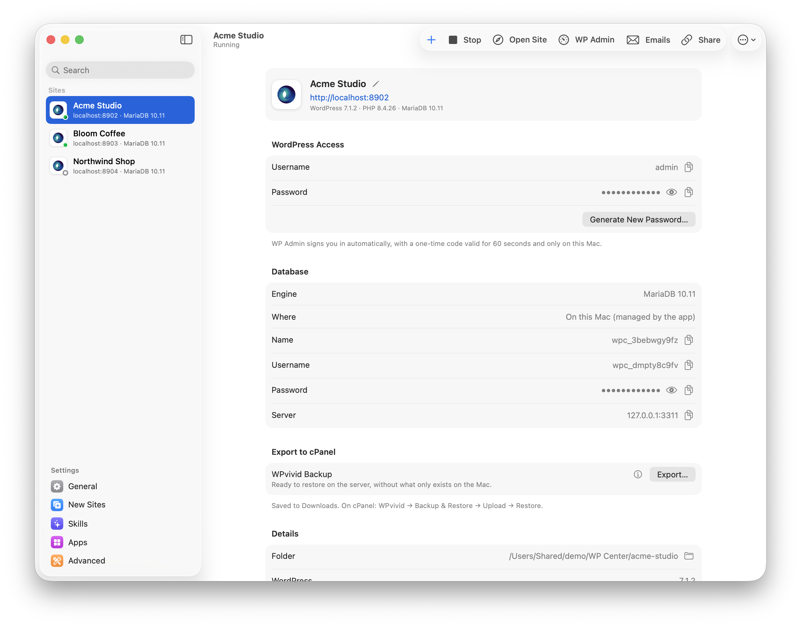
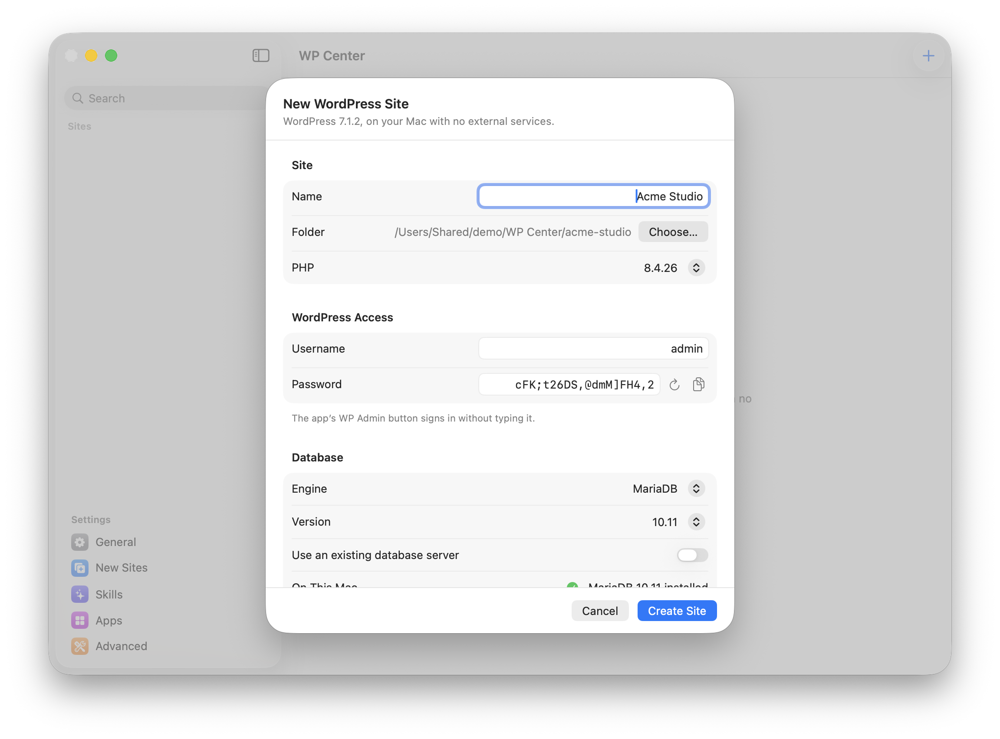
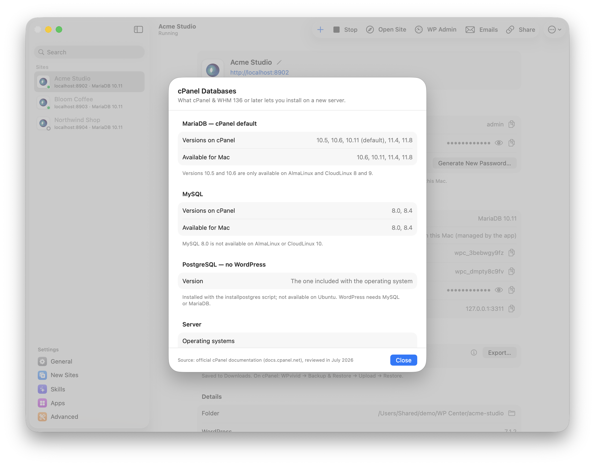
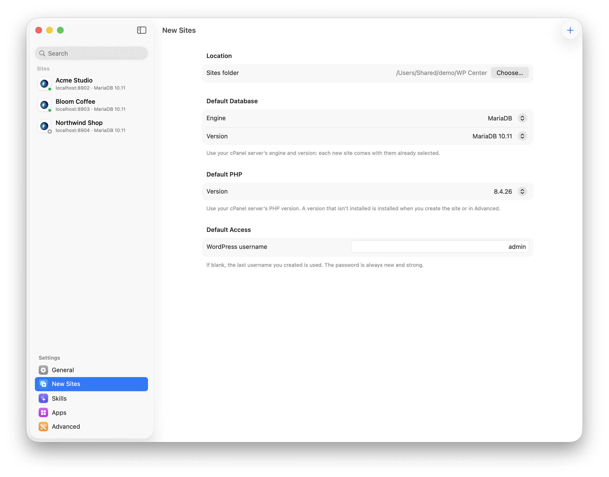
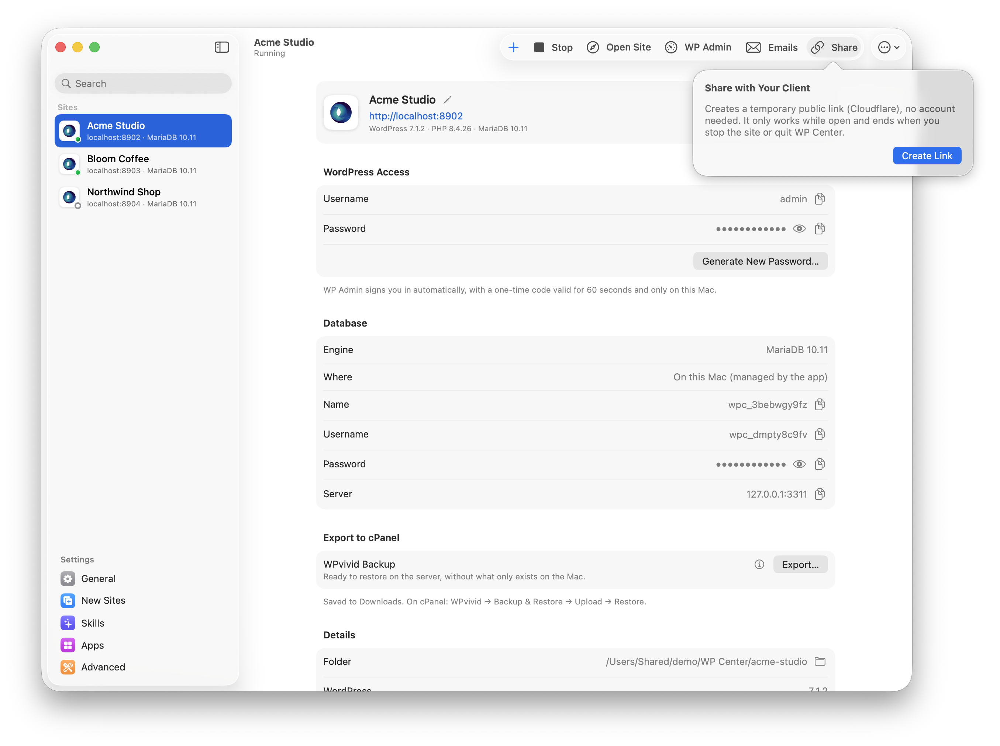
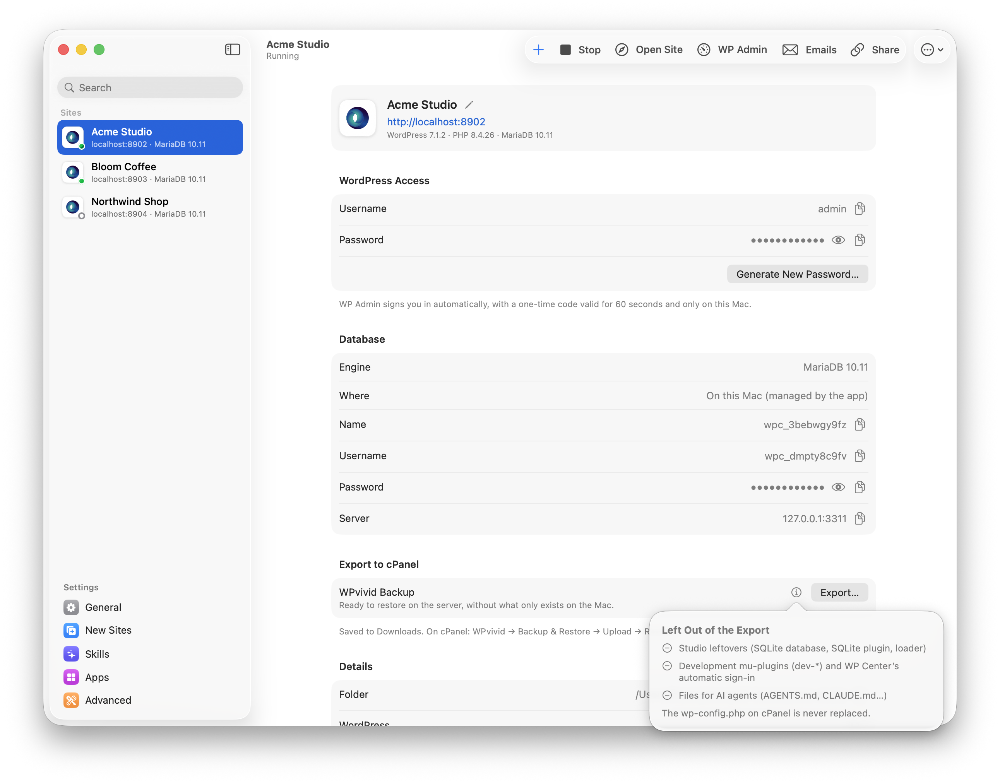
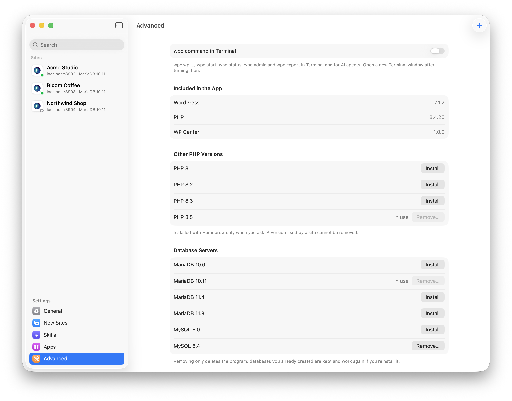

<p align="center">
  
</p>

<h1 align="center">WP Center</h1>

<p align="center">
  <strong>Local WordPress sites on your Mac, built to migrate cleanly to cPanel.</strong><br>
  A native macOS app with no accounts, no cloud and no telemetry. The only network target is <code>localhost</code>.
</p>

<p align="center">
  
  
  
  
  
  <a href="LICENSE"></a>
</p>

<p align="center">
  
</p>

---

## Table of contents

- [What is WP Center?](#what-is-wp-center)
- [Features](#features)
- [Requirements](#requirements)
- [Building from source](#building-from-source)
- [Getting started, step by step](#getting-started-step-by-step)
  - [1. Create your first site](#1-create-your-first-site)
  - [2. Start, open and sign in](#2-start-open-and-sign-in)
  - [3. Work on the site](#3-work-on-the-site)
  - [4. Test emails with Mailpit](#4-test-emails-with-mailpit)
  - [5. Share the site with a client](#5-share-the-site-with-a-client)
  - [6. Export to cPanel](#6-export-to-cpanel)
  - [7. Bring a live site from cPanel](#7-bring-a-live-site-from-cpanel)
- [The `wpc` command-line tool](#the-wpc-command-line-tool)
- [Settings](#settings)
- [How it works under the hood](#how-it-works-under-the-hood)
- [Privacy and security](#privacy-and-security)
- [Project structure](#project-structure)
- [Testing](#testing)
- [Troubleshooting](#troubleshooting)
- [Acknowledgements](#acknowledgements)
- [Contributing](#contributing)
- [License](#license)

---

## What is WP Center?

WP Center is a native macOS (SwiftUI) app for creating and running WordPress sites locally. It is a rebuild of
[WordPress Studio](https://developer.wordpress.com/studio/) with every external service removed: no WordPress.com
account, no sync, no AI, no telemetry and no auto-updates.

Its main goal is a **predictable path from your Mac to a cPanel server**. Each site can use the same database engine,
database version and PHP version as your hosting, and one click produces a
[WPvivid](https://wordpress.org/plugins/wpvivid-backuprestore/) backup ready to restore on cPanel.

## Features

| Feature | Description |
|---|---|
| **One-click sites** | Create a fully installed WordPress site in seconds, with a strong random admin password. |
| **cPanel-matched databases** | MariaDB (10.6 to 11.8) or MySQL (8.0, 8.4): the versions cPanel & WHM 136+ can install that are also available for Mac. SQLite for quick throwaway tests. |
| **PHP per site** | PHP 8.1 to 8.5, following cPanel's EasyApache 4. PHP 8.4 is bundled; other versions are installed from Homebrew only when you ask. |
| **Passwordless WP Admin** | Opens the dashboard already signed in, using a one-time, 60-second token that only works on your Mac. |
| **Export to cPanel** | Drives the WPvivid plugin to produce a clean backup and fixes MySQL 8-only collations that MariaDB rejects. |
| **Duplicate** | A full copy of a site (files and database) with its own address and password, to try things without touching the original. |
| **Import from cPanel** | Turns a WPvivid backup made on the server into a local site in one step, with local URLs and a new admin password. Exports from Studio, Local and other WP Centers work too. |
| **Email catcher** | Every email sent by WordPress lands in a bundled [Mailpit](https://mailpit.axllent.org/) inbox. Nothing leaves your Mac. |
| **Share by link** | A temporary public HTTPS link (Cloudflare Quick Tunnel), no account needed, to show your work to a client. |
| **`wpc` CLI** | Start, stop, inspect and export sites from Terminal, plus WP-CLI with each site's own PHP and database. |
| **Ready for AI agents** | Each site gets `AGENTS.md`, `CLAUDE.md`, an always up-to-date `WPCENTER.md` and WordPress skills, and `wpc` gives agents a site summary, one-time sign-in links, PHP logs, caught emails and cache clearing. Claude, ChatGPT (Codex), Cursor, Windsurf and other AI editors can open a site from the app. |
| **Menu bar and login item** | Control your sites from the menu bar and resume them automatically when you log in. |
| **English and Portuguese** | Follows your Mac's language. |

## Requirements

**To run the app**

- macOS 14 Sonoma or later, on Apple silicon.
- [Homebrew](https://brew.sh), only for MariaDB/MySQL sites and for PHP versions other than 8.4.
  WP Center installs the formulas it needs (`mariadb@10.11`, `mysql@8.4`, `php@8.2`, …) when you ask it to.

**To build from source**

- Xcode Command Line Tools (Swift 6 toolchain, macOS 26 SDK).
- [WordPress Studio](https://developer.wordpress.com/studio/), once. The build copies the PHP runtime, WordPress, the SQLite plugin,
  WP-CLI and some skills from it. **Nothing is downloaded.** By default it reads them from `Vendor/studio/` (not in git),
  a copy of the same folders inside `Studio.app/Contents/Resources`, so Studio can be uninstalled afterwards.
- `brew install mailpit cloudflared`. Both are bundled inside the app, so end users don't need them.

## Building from source

```bash
git clone https://github.com/pixelhunter1/wordpressCenter.git
cd wordpressCenter
./build.sh
open "dist/WP Center.app"
```

`build.sh` compiles the Swift sources with `swiftc`, assembles `dist/WP Center.app`, copies the runtime from Studio,
bundles Mailpit and cloudflared, and warns about any UI string that is missing an English translation.

> [!TIP]
> On a fresh clone there is no `Vendor/studio/` yet: build straight from Studio with
> `STUDIO=/Applications/Studio.app/Contents/Resources ./build.sh`.
> You can override the bundled tools the same way with `MAILPIT=` and `CLOUDFLARED=`.

---

## Getting started, step by step

### 1. Create your first site

1. Open **WP Center** and click **+** in the toolbar (or press **⌘N**).
2. Enter a **site name**. By default it is also used as the WordPress site title.
3. Choose the **database engine**:
   - **MariaDB** (*recommended*): cPanel's default engine, with `10.11` preselected.
   - **MySQL**: the same as cPanel's MySQL (`8.0` or `8.4`).
   - **SQLite**: quick tests only. It cannot be exported to cPanel.

   Pick the **same version your server runs**. **Help → cPanel Database Versions** shows the official table of what
   each operating system (AlmaLinux, CloudLinux, Ubuntu) supports.
4. Choose where the database runs:
   - **On this Mac (managed by the app)**: WP Center installs the Homebrew formula on first use, initialises it and
     creates a random cPanel-style database and user (`wpc_xxxxxxxxxx`) for the site.
   - **Existing server**: enter the host, port, database name, user and password, then click **Test Connection**.
5. Choose the **PHP version** (8.1 to 8.5). A version that isn't installed yet is installed when you create the site.
6. Optionally set the **WordPress username**. The password is always new and strong.
7. Click **Create Site**. WordPress is installed in `~/WP Center/<site-name>` (you can change the folder in Settings).

<p align="center">
  
</p>

<p align="center">
  
</p>

> [!NOTE]
> Set your server's engine, version and PHP once in **Settings → New Sites**, and every new site starts with them preselected.

<p align="center">
  
</p>

### 2. Start, open and sign in

Select the site in the sidebar. The detail view shows its status, address, credentials, database and PHP version.

| Action | Shortcut | What it does |
|---|---|---|
| **Start / Stop** | ⌘R | Starts PHP's built-in server on the site's own `localhost` port (and the database server, if needed). |
| **Open Site** | ⌘O | Opens `http://localhost:<port>` in your chosen browser. |
| **WP Admin** | ⇧⌘A | Opens `/wp-admin` **already signed in**, without typing a password. |
| **Emails** | ⇧⌘E | Opens the Mailpit inbox. |
| **Share** | | Creates a temporary public link (see step 5). |

The **More** menu adds **Show in Finder**, **Open in Editor**, **Open in Terminal**, **Copy Address**, **Rename…**
and **Delete Site…**. Deleting moves the folder to the Trash; MySQL/MariaDB databases are not deleted.

The **WordPress Access** card shows the username and password and has **Generate New Password…**. If the stored
credentials stop working, for example after restoring a WPvivid backup from production, it changes to
**Restore Access**, which resets the admin password without touching any other data.

### 3. Work on the site

The site folder is a normal WordPress install, so you can edit themes and plugins with any editor. For command-line
work use `wpc wp`, which runs WP-CLI with the site's PHP and database:

```bash
cd ~/WP\ Center/my-site
wpc wp plugin install wpvivid-backuprestore --activate
wpc wp search-replace 'https://example.com' 'http://localhost:8901' --dry-run
```

### 4. Test emails with Mailpit

When a site starts, WP Center launches the bundled Mailpit (SMTP on `127.0.0.1:1025`, web UI on `127.0.0.1:8025`).
A small mu-plugin routes `wp_mail()` there, so password resets, WooCommerce orders and contact form submissions are
caught locally instead of being sent. If another Mailpit is already using port 1025, it is reused.

### 5. Share the site with a client

1. Click **Share**, then **Create Link** (or **Start and Create Link** if the site is stopped).
2. WP Center opens a [Cloudflare Quick Tunnel](https://developers.cloudflare.com/cloudflare-one/connections/connect-networks/do-more-with-tunnels/trycloudflare/)
   and copies a `https://….trycloudflare.com` link to the clipboard.
3. Send the link. The site works over HTTPS without any database change: URLs are rewritten on the fly.
4. Click **Stop Sharing** when you're done. The link also closes when you stop the site or quit the app.

<p align="center">
  
</p>

> [!IMPORTANT]
> This is the only feature that reaches the internet, and only when you start it. Automatic sign-in is refused
> for every request that comes through the tunnel.

### 6. Export to cPanel

1. Install and activate the **WPvivid Backup** plugin in the site, for example with
   `wpc wp plugin install wpvivid-backuprestore --activate`.
2. In the **WPvivid Backup** card, click **Export…**.
3. If any table uses a MySQL 8-only collation (`utf8mb4_0900_*`), WP Center warns you and offers:
   - **Convert and Export** (*recommended*): converts to `utf8mb4_unicode_ci`, which works on both MySQL and MariaDB. Your data is kept.
   - **Export Without Converting**: only if your cPanel uses MySQL 8.
4. The backup files are saved to a subfolder named after the site and the date, in `~/Downloads` by default
   (configurable in Settings, or ask every time).
5. On cPanel, in a WordPress site with WPvivid installed: **WPvivid → Backup & Restore → Upload → Restore**.

**Left out of the export**, so the server gets only what belongs there:

- Studio leftovers (SQLite database, SQLite plugin and loader);
- development mu-plugins (`dev-*`) and WP Center's own mu-plugins (automatic sign-in, mail, sharing);
- files for AI agents (`AGENTS.md`, `CLAUDE.md`, `.claude/`, `.agents/`, …).

The `wp-config.php` on cPanel is never replaced.

<p align="center">
  
</p>

### 7. Bring a live site from cPanel

1. On the server, in **WPvivid → Backup & Restore**, make a backup of the **database and files** and download it.
   Large backups come in several parts (`….part001.zip`, `….part002.zip`); keep them in the same folder.
2. In WP Center: **File → Import Site…** and choose the backup (any one part is enough). WP Center shows
   **WPvivid** as the source and suggests the domain as the name.
3. Click **Import**. WP Center creates the site with its own database on the managed MariaDB/MySQL, swaps the live
   URLs for `http://localhost:<port>` and gives the first administrator a new password.

The WPvivid plugin isn't needed on your Mac, and the live site is never touched. Exports from WordPress Studio, Local
and another WP Center are imported the same way (`wpc import <file>` from Terminal).

---

## The `wpc` command-line tool

Turn it on in **Settings → Advanced → wpc command in Terminal**. This creates `~/.local/bin/wpc`, a symlink to the
app. Make sure `~/.local/bin` is in your `PATH`, then open a new Terminal window.

```text
Usage: wpc [--path <site-folder>] <command>

  wpc list            List the sites (--json)
  wpc status          Status, address, credentials and database of the site (--json)
  wpc context         Summary for agents: theme, builder, plugins, content, WooCommerce (--json)
  wpc start           Start the site (and the database server, if needed)
  wpc stop            Stop the site
  wpc admin           Open wp-admin already signed in
  wpc login-url [page] One-time wp-admin sign-in link (e.g. plugins.php), valid for 60 s
  wpc flush           Clear caches: object cache, transients, permalinks, Elementor, cache plugins
  wpc logs [lines]    Recent PHP errors and wp-content/debug.log
  wpc mail [ID]       Latest emails caught by Mailpit; with an ID, shows one as text (--json)
  wpc export          WPvivid backup ready to restore on cPanel
                        --convert     fix MySQL 8 collations
                        --no-convert  keep them (MySQL 8 servers only)
  wpc duplicate       Full copy of the site (files and database); --name "Name"
  wpc import <file>   Create a site from a WPvivid backup or a Studio, Local or WP Center export
  wpc wp <args…>      WP-CLI with the site's PHP and database
```

Commands act on the site in the current folder, or the one given with `--path`. Sites started from the CLI keep
running after the command exits, and the app and `wpc` can stop each other's servers.

## Settings

| Pane | What you can configure |
|---|---|
| **General** | Open at login · what happens when WP Center opens (resume the sites that were running, or start none) and when it quits (stop the sites, or keep them running) · menu bar icon · export folder. |
| **New Sites** | Sites folder · default database engine, version and PHP version, to match your cPanel server. |
| **Skills** | Skills for AI agents, copied into each site's `.claude/skills` and `.agents/skills`. Turning one off removes it from every site. |
| **Apps** | Browser, code editor and terminal used by Open Site, WP Admin, Open in Editor and Open in Terminal. |
| **Advanced** | `wpc` command · install or remove PHP versions · installed database servers, with **Remove…** for unused ones. |

<p align="center">
  
</p>

---

## How it works under the hood

```
┌────────────────────────────── WP Center.app ──────────────────────────────┐
│  SwiftUI GUI  ·  wpc CLI  ·  --selftest      (one executable, three modes)│
│                                                                            │
│  SiteStore ──► php -S 127.0.0.1:<port> router.php       (one per site)     │
│      │           └─ bundled PHP 8.4, or Homebrew php@8.x                   │
│      ├──────► mariadbd / mysqld    ports 3310+ / 3320+, socket in /tmp     │
│      ├──────► mailpit              SMTP :1025 · UI :8025                   │
│      └──────► cloudflared          only while a share link is open         │
│                                                                            │
│  Runtime/*.php ─ helpers run with `wp eval-file`, inputs via env vars      │
└────────────────────────────────────────────────────────────────────────────┘
```

- **Web server.** Each site is served by PHP's built-in server with 4 workers. Port checks cover both `127.0.0.1`
  and `::1`, so `localhost` works in every browser. Stopping a site ends the whole process tree.
- **Databases.** Versioned, keg-only Homebrew formulas, each with a fixed port and its own data directory in
  `~/Library/Application Support/WP Center/Databases/`. Servers start with `utf8mb4_unicode_ci` as the default
  collation, which keeps backups compatible with MariaDB on cPanel. Each site gets its own random database and user.
- **WordPress configuration.** The generated `wp-config.php` disables automatic core updates, so a background update
  never contacts wordpress.org mid-request. You can still update manually from the dashboard.
- **Helper scripts.** `Runtime/*.php` run inside the site through WP-CLI. They read their inputs from environment
  variables, never argv, so secrets don't show up in `ps`, and they return one `WPCENTER_RESULT {json}` line.
- **State.** `~/Library/Application Support/WP Center/` holds `sites.json` (mode `0600`), per-site logs and database data.

## Privacy and security

- **No external services.** No accounts, analytics, crash reporting or update checks. Sharing by link is the only
  outbound connection, and only while a link is open.
- **Automatic sign-in** uses a one-time token stored only as a SHA-256 hash. It is valid for 60 seconds and accepted
  only in the `local` environment, only from loopback and never through a share tunnel.
- **Managed databases** give root access only through a local Unix socket, with no password and no network access.
- **Credentials** are stored in `sites.json` with owner-only permissions and passed to helpers through environment variables.

## Project structure

```
Sources/WPCenter/
  App.swift          entry point (GUI, CLI, self-test) and the SelfTest suite
  Engine.swift       SiteStore: sites, servers, PHP versions, export, sharing, Mailpit
  Database.swift     database engines and the official cPanel version table
  CLI.swift          the wpc command
  Preferences.swift  settings, login item, browser/editor/terminal choice
  Views.swift        all SwiftUI views
Runtime/             router, PHP helpers, mu-plugins and AI-agent skills copied into the app
Localization/        en.lproj (English text), pt-PT.lproj and pt.lproj
Assets/, Scripts/    logo and app icon generator
build.sh             builds dist/WP Center.app
```

## Testing

There is no XCTest target. The app ships with an end-to-end self-test:

```bash
"dist/WP Center.app/Contents/MacOS/WPCenter" --selftest
```

It creates real sites in a temporary folder (SQLite, every installed managed MariaDB/MySQL version and every installed
Homebrew PHP), starts them, makes HTTP requests and checks sign-in, access reset, rename, collations, PHP versions and
stop behaviour. Exit code `0` means every check passed.

## Troubleshooting

| Problem | Fix |
|---|---|
| **"Homebrew is not installed"** | Install it from [brew.sh](https://brew.sh) and try again. It's only needed for MariaDB/MySQL and extra PHP versions. |
| **"Port … is in use by another app"** | Another database server (or Studio) is using that port. Stop it, then start the site again. |
| **The site didn't start** | The error shows the log path: `~/Library/Application Support/WP Center/Logs/<site-id>.log`. |
| **Credentials stopped working after a restore** | Use **Restore Access** in the WordPress Access card. |
| **"The WPvivid plugin is not active on this site"** | Install and activate WPvivid Backup before exporting. |
| **`wpc: command not found`** | Turn on the command in Settings → Advanced, add `~/.local/bin` to your `PATH` and open a new Terminal window. |
| **A new build doesn't seem to apply** | Quit the running app first: `osascript -e 'tell application id "local.wpcenter" to quit'`. |

## Acknowledgements

WP Center builds on
[WordPress](https://wordpress.org), [WordPress Studio](https://github.com/Automattic/studio),
[WP-CLI](https://wp-cli.org), [SQLite Database Integration](https://github.com/WordPress/sqlite-database-integration),
[WPvivid](https://wordpress.org/plugins/wpvivid-backuprestore/), [Mailpit](https://github.com/axllent/mailpit),
[cloudflared](https://github.com/cloudflare/cloudflared), [WordPress agent skills](https://github.com/WordPress/agent-skills)
and [Homebrew](https://brew.sh).

WP Center is an independent project and is not affiliated with Automattic, WordPress.com, cPanel, WPvivid or Cloudflare.

## Contributing

Bug reports and pull requests are welcome. See [CONTRIBUTING.md](CONTRIBUTING.md) for how to build, test and follow the
project's conventions.

## License

WP Center is free software, released under the [GNU General Public License v2.0 or later](LICENSE), the same licence as
WordPress and WordPress Studio.

The built app bundles third-party components that keep their own licences:

| Component | License |
|---|---|
| [WordPress](https://wordpress.org) | GPL-2.0-or-later |
| [SQLite Database Integration](https://github.com/WordPress/sqlite-database-integration) | GPL-2.0-or-later |
| [WordPress agent skills](https://github.com/WordPress/agent-skills) (`Runtime/skills`) | GPL-2.0-or-later |
| Agent skills from [WordPress Studio](https://github.com/Automattic/studio) | GPL-2.0-or-later |
| [WP-CLI](https://wp-cli.org) | MIT |
| [PHP](https://www.php.net) | PHP License 3.01 |
| [Mailpit](https://github.com/axllent/mailpit) | MIT |
| [cloudflared](https://github.com/cloudflare/cloudflared) | Apache-2.0 |
